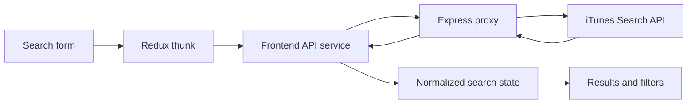

# NextMusic

Search the iTunes catalogue for artists, songs and albums, explore the results, and listen to available audio previews. NextMusic combines a responsive React interface with an Express API that handles catalogue requests and production hosting.

[Open NextMusic](https://next-music-search.vercel.app/) · [API health](https://nextmusic-api.vercel.app/api/health)

<details>
<summary>View the interface</summary>

**Search and discovery**


**Catalogue results**


**Audio previews**


Screenshots illustrate catalogue searches; live results and interface details can change.

</details>

## What it does

- Searches artists, songs and albums together, with filters and counts for each type.
- Shows ten results initially and reveals ten more on scroll, with a Show more alternative.
- Keeps artists first, followed by songs and albums; available artwork leads within each type.
- Shows loading skeletons, an explicit empty state and actionable errors with retry.
- Offers suggested searches and Apple Music links alongside real catalogue data.
- Plays one preview at a time in a shared player with native playback controls.
- Keeps the header fixed while the page scrolls, with a keyboard-accessible skip link.

## Run locally

Requires **Node.js 22.18+** and npm. No API key or environment file is needed.

```sh
git clone https://github.com/Pcharlesme/NextMusic.git
cd NextMusic
npm ci
npm run dev
```

Open **http://localhost:5173**. This starts Vite and Express; Vite forwards `/api` requests to the backend on port **3001**. The interface can render independently, but catalogue search and featured artwork require the API.

To manage the processes separately, run these in two terminals:

```sh
npm run dev --workspace=@nextmusic/server
npm run dev --workspace=@nextmusic/web
```

### Production

```sh
npm run build
npm start
```

Open **http://localhost:3001**. Express serves the compiled frontend from `web/dist` and handles API requests on the same origin. Set `PORT` for a different production port, for example `PORT=8080 npm start`. The development proxy remains configured for 3001.

### Checks

```sh
npm test
npm run typecheck
npm run build
```

There is no configured lint command. Vite's standalone preview does not supply the backend API.

## Architecture



Components submit queries and render state. `musicApi.ts` handles browser requests, response validation and normalization. Express owns query validation, the fixed Apple URL and upstream failures. Redux keeps the submitted query, fetched items, request status and visible count together.

| Technology | Purpose |
| --- | --- |
| React + TypeScript | Typed components and UI behavior. |
| Redux Toolkit + Redux Thunk | Asynchronous searches, request states and result visibility. |
| Vite | Frontend development and production builds. |
| Material UI + Emotion + CSS | Shared controls, theming and responsive styling. |
| Node.js + Express | Search proxy, health endpoint and static hosting. |
| Vitest | Frontend service, Redux and HTTP endpoint tests. |

## Decisions behind the implementation

**Fetch once, reveal in tens.** The app progressively reveals an already-fetched selection. Scrolling does not request an offset or imply access to the complete catalogue. Changing filters resets visibility to ten; the final batch can contain fewer items.

**One model for three result types.** Apple returns different fields for artists, songs and albums. Normalization produces stable type-prefixed IDs, drops unusable records, removes duplicates and keeps artwork, duration and preview links optional. Results order as artists → songs → albums without changing relevance order within otherwise equivalent items.

**Predictable request states.** Redux Toolkit supplies Thunk middleware without additional setup. A new search cancels its predecessor, and request IDs prevent a late response from replacing newer results. The browser deadline is 15 seconds; the upstream Apple deadline is ten. Successful empty responses and failed requests produce different UI states.

**A small server boundary.** Express accepts only a trimmed search term of 1–200 characters and contacts a fixed iTunes endpoint. Invalid queries return 400; upstream errors, invalid responses and timeouts return a safe 502. The browser does not depend on Apple's cross-origin permissions.

**Native controls where they help.** Search uses a labeled form and Enter key support. Results use headings and lists, and status updates are announced politely. Audio uses browser controls for playback, seeking and volume; closing the player returns focus to its trigger. The header's reserved space and scroll offsets keep content from sitting behind it.

**Delivery without a separate infrastructure layer.** Express compresses eligible responses. Content-versioned JavaScript and CSS receive immutable caching; HTML and unversioned assets remain revalidatable. The optional player loads separately from the initial application bundle.

## Project layout

```text
server/
  index.ts                  Shared Express application and local startup
  api/index.ts              Vercel adapter using the same application
  index.test.ts             HTTP endpoint and delivery tests
  vercel.json               Backend deployment routing
web/
  src/app/                  Store, typed hooks and theme
  src/components/           Header, search form and suggestions
  src/features/search/      Search state and result components
  src/features/player/      Shared audio-preview player
  src/services/             API normalization and service tests
  src/data/                 Suggested search terms
  public/assets/            Branding and interface screenshots
  vercel.json               Same-origin API forwarding
```

## Testing

**53 tests passed in the latest verification:** 19 frontend tests and 34 Express/adapter tests.

| Area | Coverage |
| --- | --- |
| API service | Normalization, ordering, duplicate removal, invalid records, cancellation, timeouts and failures. |
| Redux | First ten results, subsequent batches, resets, stale requests and empty/error states. |
| Express | Health, validation, successful and empty searches, upstream failures, static files and missing routes. |
| Delivery and adapter | Compression, cache boundaries, callable exports and emitted `.js` import paths. |

Tests isolate Apple responses; server tests still send real HTTP requests to Express on temporary local ports. Browser interaction checks have also been run separately, but are not a committed automated UI suite.

## Deployment

The public frontend and API are separate Vercel projects. `web/vercel.json` forwards `/api/*` to `https://nextmusic-api.vercel.app/api/*`, so browser requests remain same-origin.

| Setting | Frontend | Backend |
| --- | --- | --- |
| Root Directory | `web` | `server` |
| Framework | Vite | Other |
| Build Command | `npm run build` | Empty |
| Output Directory | `dist` | Default |
| Node.js | 22.x | 22.x |

Enable **Include source files outside of the Root Directory** for both projects because their TypeScript settings extend the root configuration. Install build-time dependencies as well as runtime dependencies.

The backend adapter exports the existing Express app without starting a local listener. TypeScript rewrites relative `.ts` imports to `.js` during emission so imports match the packaged files. Local development still executes the original TypeScript. Deploy the backend first, then the frontend.

```sh
curl https://nextmusic-api.vercel.app/api/health
curl 'https://next-music-search.vercel.app/api/search?term=Adele'
```

Health returns `{"status":"ok","service":"nextmusic"}`. It checks the Express process, not Apple's availability. On a conventional Node host, use the root build/start commands to serve both frontend and API in one process.

## Boundaries and trade-offs

- The combined Apple request uses `limit=50`, but multiple entities can yield more than fifty total records. Counts describe the fetched selection, not an exhaustive catalogue total.
- A popular query can return 60 matches: a live Adele request returned 50 songs, four artists and six albums. That is Apple's response, not a fixed application count. An unmatched query returns zero. The page reveals ten returned matches at a time; scrolling does not request another catalogue page.
- Artwork and preview availability vary by record and country. Missing images have fallbacks; a preview control appears only when Apple supplies a URL. Previews are short clips, not full-track streaming.
- Featured artwork depends on a live query. External API, image and font timing can affect loading; a Lighthouse score is not a guarantee for every visit.
- Clean Chrome audits on 18 November 2026 measured the deployed site at 92, 92 and 94 for mobile performance, with Accessibility, Best Practices and SEO at 100. Local before/after runs both had a median of 86; the image priority change did not produce a measurable score increase. An API preload experiment was also removed after failing to improve the score. The main featured cover receives high image priority; explicit image dimensions preserve its aspect ratio before it loads.
- Artist and album cards coexist with song rows. All three are rendered as semantic lists, with different layouts suited to their metadata.
- Suggestions are predefined search terms, not generated search results. Production requests never fall back to mock catalogue data.

Music data, artwork and audio previews are provided by Apple iTunes.
