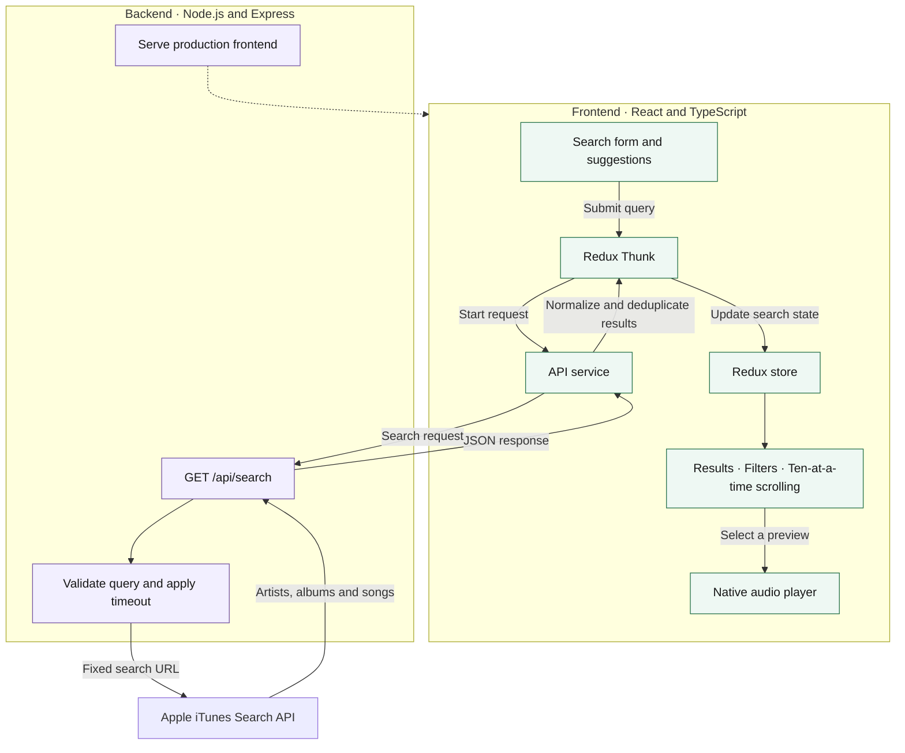
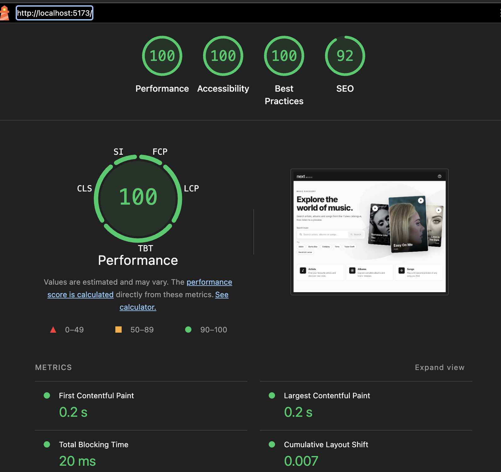

# NextMusic

Search the iTunes catalogue for artists, songs and albums, filter matching results, and listen to available audio previews.

[Live application](https://next-music-search.vercel.app/) · [Backend health](https://nextmusic-api.vercel.app/api/health)


## Features

- Search the iTunes catalogue for an artist, album or song and view related results, with filters for each type.
- Display ten results initially and reveal ten more on scroll, with a Show more button as an alternative.
- Show loading feedback, an explicit no-results message and error states with retry.
- Clear the search field or start a search from the suggested artists.
- Play one song preview at a time, pause and seek using the native audio player.
- Adjust volume and playback speed, or download the preview where the browser exposes these native controls. Downloads are preview clips, not full songs.
- Open artists, albums and songs on Apple Music; close the player with its button or Escape.
- Support keyboard submission, labelled controls, result announcements and focus restoration when the player closes.

## Getting started

Requires **Node.js 22.18+** and npm. No API key or environment file is required.

```sh
git clone https://github.com/Pcharlesme/NextMusic.git
cd NextMusic
npm i
npm run dev
```

This starts both workspaces:

- **Frontend:** http://localhost:5173
- **Express API:** http://localhost:3001/api/health

Vite forwards `/api` requests to Express on port **3001**.

Alternatively, after installing dependencies at the repository root, start each workspace in its own terminal.

**Backend — from the repository root:**

```sh
cd server
npm run dev
```

**Frontend — from the repository root in another terminal:**

```sh
cd web
npm run dev
```

### Production

```sh
npm run build
npm start
```

Express serves the compiled frontend and API at **http://localhost:3001**. The server accepts `PORT` to change its listening port. The development proxy remains configured for port 3001.

## Technologies

- **React and TypeScript** for the interface and shared result types.
- **Redux Toolkit and Redux Thunk** for search state and asynchronous requests.
- **Material UI, Emotion and CSS** for controls, theming and responsive layout.
- **Vite** for frontend development and production builds.
- **Node.js and Express** for the iTunes proxy and production static serving.
- **Vitest and React Testing Library** for service, state, component and HTTP tests.

## Architecture



The interface submits queries through a thunk. The API service requests data from Express, validates the response and normalizes its records. The thunk stores those results in Redux for the result lists and filters.

### Technical decisions

- **Express proxy:** browser requests stay on the application's origin, avoiding direct cross-origin requests to iTunes. The server validates search terms, uses a fixed upstream URL and applies a timeout.
- **Asynchronous state:** Redux Thunk keeps loading, success, empty and error transitions alongside the submitted query and results.
- **Stale requests:** a new search cancels its predecessor. Request IDs prevent late responses or errors from overwriting a newer search.
- **Mixed result types:** artist, album and song records become a common model with type-prefixed IDs. Duplicate records are removed, and missing artwork or metadata is handled without discarding otherwise usable results.
- **Incremental display:** the page starts with ten items and increases visibility by ten on scroll or through Show more. A new query or filter resets visibility to ten.

## Project structure

```text
server/
  index.ts                 Express application, API routes and local startup
  api/index.ts             Vercel entry point
  index.test.ts            HTTP, static-serving and adapter tests
web/
  src/app/                 Store, typed hooks and theme
  src/components/          Header, search form and suggestions
  src/features/search/     Search state, result lists, filters and tests
  src/features/player/     Shared audio preview player
  src/services/            API requests, normalization and tests
  src/App.test.tsx          Search and player integration tests
  public/assets/           Branding and screenshots
```

## Testing

**Latest executed result: 68/68 tests passed — 32/32 frontend and 36/36 backend.**

From the repository root:

```sh
npm run test
npm run lint
npm run typecheck
```

Individual workspace test suites:

```sh
npm run test --workspace=@nextmusic/web
npm run test --workspace=@nextmusic/server
```

**Frontend:** Vitest covers normalization, cancellation, timeouts, Redux transitions and stale responses. React Testing Library and user-event exercise submission, filtering, ten-at-a-time scrolling, empty/error states, retry and player errors against the real Redux store. Component tests use jsdom with simulated layout and media APIs.

**Backend:** Vitest sends HTTP requests to Express on temporary local ports. Tests cover query validation, upstream failures and timeouts, static serving, compression, caching and the Vercel adapter. Apple responses and static files use isolated fixtures, so tests need neither internet access nor a prior frontend build.

## Trade-offs

- Searches use the UK store and request a bounded selection with `limit=100`. Mixed-entity responses can exceed that number; displayed counts describe the returned selection, not the entire catalogue.
- Scrolling reveals fetched records locally rather than requesting additional API pages.
- Artwork, metadata and preview URLs depend on availability. Previews are short clips, not full tracks.
- Search and featured artwork depend on Apple's API and image services, so loading times vary with external responses.

## Local Lighthouse snapshot



## Deployment

The [frontend](https://next-music-search.vercel.app/) and [Express API](https://nextmusic-api.vercel.app/api/health) run as separate Vercel projects. The frontend forwards `/api` requests to the API project through [its routing configuration](web/vercel.json); the backend exports the same Express application through [its Vercel entry point](server/api/index.ts).

Both deployments use Node.js 22 and share the repository's base TypeScript configuration. The health endpoint reports whether Express is running; it does not check Apple's availability.

Music data, artwork and previews are provided by Apple iTunes.
