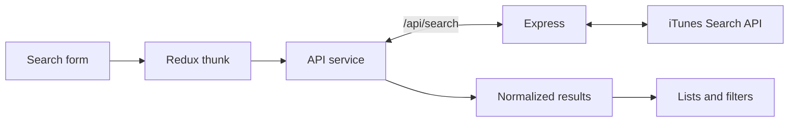

# NextMusic

Search the iTunes catalogue for artists, songs and albums, filter the results, and listen to available audio previews.

[Live app](https://next-music-search.vercel.app/) · [API health](https://nextmusic-api.vercel.app/api/health)

<details>
<summary>Screenshots</summary>


</details>

## Getting started

Requires **Node.js 22.18+** and npm. No API key or environment file is required.

```sh
npm ci
npm run dev
```

Open **http://localhost:5173**. The command starts Vite and Express. Vite forwards `/api` requests to Express on port **3001**; search and featured artwork require the backend.

The workspaces can also run in separate terminals:

```sh
npm run dev --workspace=@nextmusic/server
npm run dev --workspace=@nextmusic/web
```

### Production

```sh
npm run build
npm start
```

Open **http://localhost:3001**. Express serves `web/dist` and the API on the same origin. The server accepts a `PORT` environment variable; the development proxy uses port 3001.

## Stack and architecture

React and TypeScript provide the interface, with Material UI, Emotion and CSS for styling. Redux Toolkit supplies the store and Thunk middleware. Vite handles frontend builds, Express proxies Apple requests and serves production assets, and Vitest runs the tests.



- **API boundary:** Express validates queries, contacts a fixed Apple endpoint and applies an upstream timeout. The frontend service validates responses and normalizes artists, albums and songs into one model with stable, type-prefixed IDs.
- **Search state:** Redux holds the submitted query, results, request status and visible count. New searches cancel the previous request; request IDs prevent stale responses from replacing newer results. Empty responses and request failures have separate states.
- **Result visibility:** ten items appear initially, with ten more revealed on scroll or through Show more. Filters reset visibility to ten. Artists appear first, followed by songs and albums, with available artwork first within each type.
- **Interaction:** the search form supports Enter, results use semantic lists, and loading/result updates are announced. The fixed header has a skip link. A shared player uses native audio controls and restores focus when closed.
- **Delivery:** Express compresses responses and caches versioned assets. Header space is reserved before React loads, and a local font fallback reduces movement while Inter downloads.

```text
server/
  index.ts                  Express app, search proxy and local startup
  api/index.ts              Vercel entry point
  index.test.ts             HTTP, static-serving and adapter tests
web/
  src/app/                  Store, typed hooks and theme
  src/components/           Header, search form and suggestions
  src/features/search/      Search state, filters and result lists
  src/features/player/      Audio preview player
  src/services/             API requests, normalization and tests
  src/data/                 Suggested search terms
  public/assets/            Branding and screenshots
```

## Testing

```sh
npm run lint
npm run typecheck
npm test
npm run build
```

Service tests cover response normalization, request cancellation, timeouts and failures. Redux reducer tests cover state transitions, stale responses, empty/error states and ten-at-a-time visibility. Backend tests cover query validation, mocked upstream responses and failures, static serving, compression, caching and the Vercel adapter. Express tests use temporary local HTTP ports and static fixtures; they do not require a prior frontend build or Apple's availability.

ESLint checks both workspaces and tests, including React hook usage and dependencies. Prettier handles formatting separately. There is no committed automated browser suite. Vite's standalone preview does not provide the backend API.

## API limitations

- Searches use the UK iTunes store and request artists, albums and songs together with `limit=100`. Mixed-entity responses can contain more records than the requested limit. Displayed counts describe the fetched selection, not a catalogue-wide total.
- Scrolling reveals already-fetched results; it does not request additional pages. The app does not provide exhaustive catalogue search.
- Artwork, metadata and preview URLs are optional. Playback controls appear only when a preview URL is available. Previews are short clips rather than full tracks.
- Search and featured artwork depend on Apple's availability. External API, image and font requests affect loading time.

## Deployment

The frontend and API are deployed as separate Vercel projects. `web/vercel.json` forwards `/api/*` to the API project, keeping browser requests on the frontend origin.

| Setting | Frontend | Backend |
| --- | --- | --- |
| Root Directory | `web` | `server` |
| Framework | Vite | Other |
| Build Command | `npm run build` | Empty |
| Output Directory | `dist` | Default |
| Node.js | 22.x | 22.x |

Both projects need access to files outside their root directory because their TypeScript configurations extend the root configuration. Build-time dependencies must be installed. The backend exports the shared Express app without starting a listener; relative TypeScript imports are rewritten during compilation.

The health endpoint is `/api/health`. It reports whether Express is running, not whether Apple is available. A conventional Node host can serve both frontend and API with the root production commands above.

Music data, artwork and audio previews are provided by Apple iTunes.
